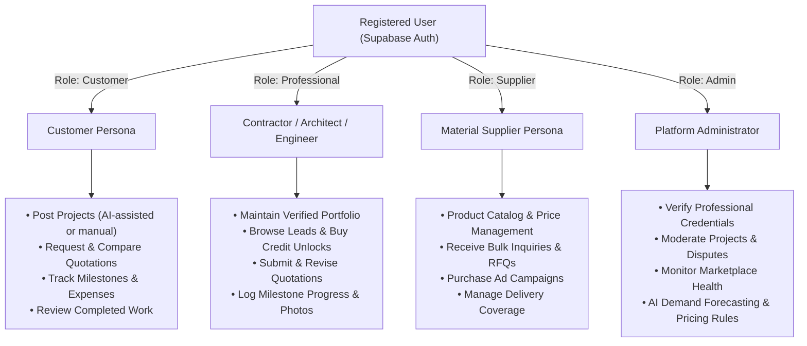
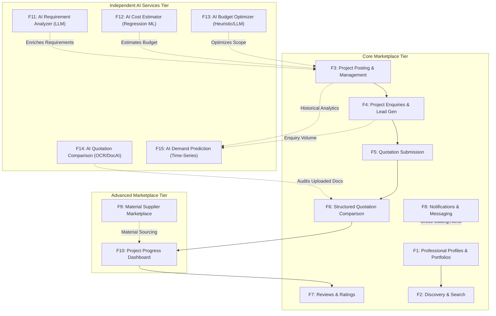
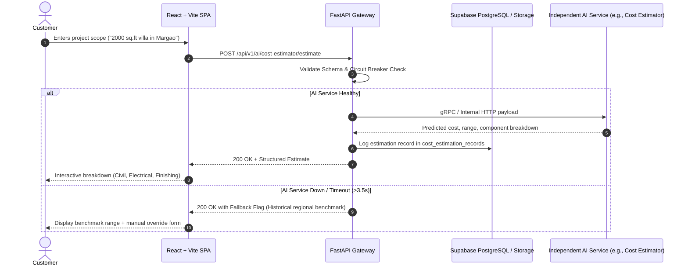

# Deliverable 1: Complete Product Architecture — BuildWise

> [!NOTE]
> **BuildWise** is an AI-powered construction marketplace designed to bridge property owners, builders, contractors, architects, civil engineers, interior designers, and building material suppliers into a single, cohesive, intelligent ecosystem.

---

## 1. Executive Summary & Value Proposition

In the traditional construction ecosystem (specifically focused initially on Goa, India, with expansion potential across India), initiating and managing a construction or renovation project is fragmented and opaque:
- **Customers** struggle to identify vetted architects, civil engineers, contractors, and material vendors, comparing disparate paper/PDF quotations manually with unclear pricing benchmarks.
- **Service Providers & Contractors** lack predictable client discovery mechanisms, relying on word-of-mouth with high client acquisition friction.
- **Material Suppliers** operate in localized silos with limited direct digital access to ongoing residential and commercial projects.

**BuildWise solves this by unifying the entire lifecycle:**
1. **Intelligent Discovery & Requirement Translation:** Converting plain-language ideas into structured project bills of quantities (BOQ) and requirements via natural language processing.
2. **Predictive Costing & Budget Guardrails:** Deterministic ML models predicting local cost per sq. ft. alongside automated budget optimization before a single rupee is committed.
3. **Structured & AI-Audited Bidding:** Side-by-side structured comparison combined with an independent document intelligence pipeline that extracts, parses, and audits uploaded PDF/scanned contractor quotations.
4. **Lifecycle Collaboration & Accountability:** Milestone-based tracking, escrow-friendly progress updates, and verified reviews.
5. **Integrated Monetization:** A sustainable commercial engine combining lead credits, tier subscriptions, marketplace commissions, promoted visibility, and supplier advertising.

---

## 2. Platform User Roles & Permission Boundaries

BuildWise implements strict **Role-Based Access Control (RBAC)** across four primary user personas:

### Role Capabilities & Access Boundaries

| Role | Allowed Capabilities | Restricted / Denied Capabilities |
| :--- | :--- | :--- |
| **Customer** | Post/edit/close projects, run AI requirement analyzer, run AI cost estimator, view interested professionals, shortlist leads, receive & compare quotations, run AI quotation audit on uploaded docs, track project milestones/expenses, write reviews for completed projects. | Cannot browse private leads of other customers, cannot submit quotations, cannot access contractor lead management dashboards or admin controls. |
| **Professional** (Contractor, Architect, Engineer, Interior Designer) | Maintain business profile & portfolio, search published projects, express interest via lead credits, prepare and submit itemized quotations, update milestones and site photos for awarded projects, receive client reviews. | Cannot edit customer project requirements, cannot view competitor quotation amounts prior to selection, cannot moderate reviews or bypass lead credit deductions. |
| **Material Supplier** | Manage catalog items, unit pricing, inventory status, delivery radiuses, receive material inquiries/RFQs, quote on material packages, purchase sponsored product ads. | Cannot bid as a primary construction contractor without a verified professional role; cannot access private customer milestone records. |
| **Administrator** | Access system analytics, verify professional licenses/GSTIN, audit transactions & platform commissions, configure pricing/credit costs, review flagged quotations or disputes, access AI Demand Prediction. | Cannot alter customer or professional agreement details without audit log entries. |

---

## 3. The 15 Selected Features & Unified Architecture

BuildWise is organized into three coherent tiers encompassing all 15 core features:

---

## 4. End-to-End Core Data Flow Architecture

The platform adheres to a zero-coupling philosophy between business logic and AI models:

---

## 5. Technology Stack Selection & Justification

| Layer | Selected Technology | Architectural Justification |
| :--- | :--- | :--- |
| **Frontend** | **React (Vite) + Tailwind CSS + TypeScript + React Router v6** | Blazing fast build tooling (Vite), type safety for complex financial/construction schemas, zero-runtime CSS bloat via Tailwind, clean single-page app component hierarchy with shared layouts. |
| **Backend API** | **Python (FastAPI) + Pydantic v2 + Uvicorn** | Native async concurrency, automatic OpenAPI contract generation, seamless interop with Python data science/ML pipelines, strict Pydantic payload validation. |
| **Database & Auth** | **Supabase (PostgreSQL 15) + Supabase Auth + Supabase Storage** | Enterprise-grade relational integrity, built-in Row-Level Security (RLS) enforcement, robust object storage for blueprints/site photos with signed CDN URLs. |
| **AI / ML Layer** | **Independent Microservices (FastAPI / Colab-trained artifacts)** | Independent failure boundaries. ML models (XGBoost/RandomForest) serialized via Joblib; DocAI utilizing OCR (Tesseract / PyMuPDF) + structured LLM prompting with fallback heuristics. |

---

## 6. Commercial Model Integration

The business architecture embeds monetization seamlessly into operational workflows without obstructing basic UX:
1. **Lead Credits (Simulated Pay-per-Lead):** Contractors receive anonymized project alerts free of charge. Unlocking customer contact coordinates or bidding consumes lead credits from a prepaid wallet balance.
2. **Tiered Subscriptions:** Free, Basic (₹299/mo), and Premium (₹799/mo) plans governing portfolio image limits, verified badges, and search boost rankings.
3. **Transaction Commissions:** Transparent 2% platform fee calculated upon formal milestone contract award.
4. **Promoted Listings & Supplier Ads:** Search-topping sponsored cards for vendors and suppliers, strictly labeled with `SPONSORED` flags to preserve customer trust.
