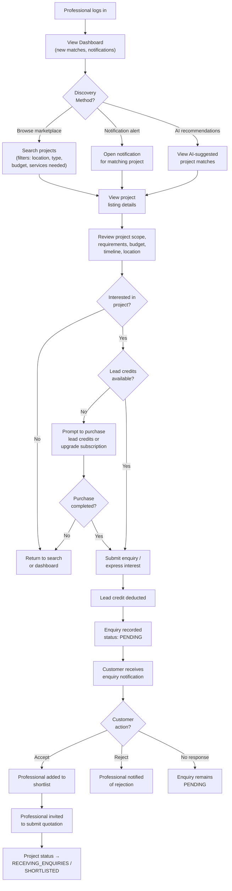
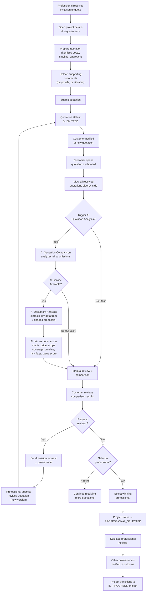
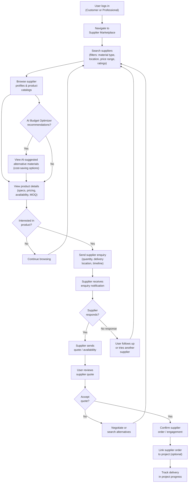
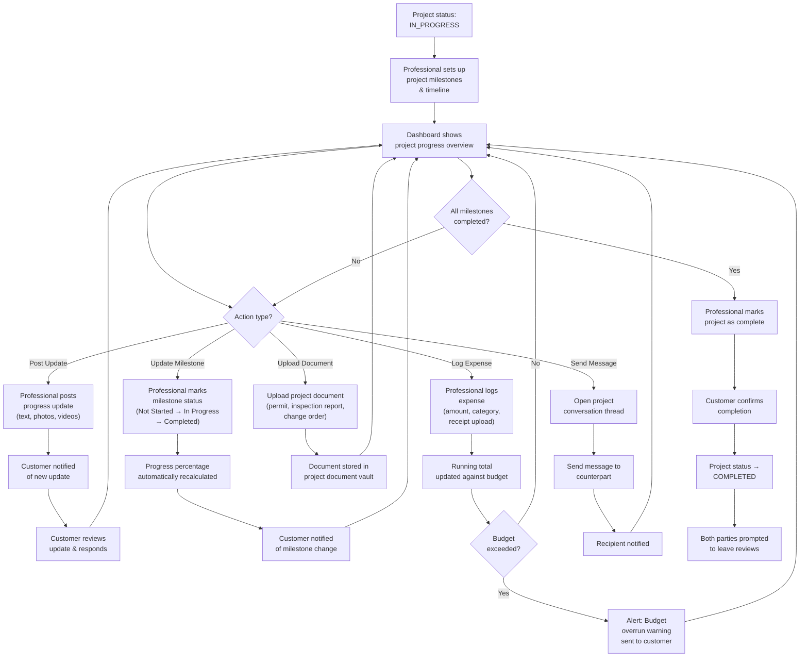
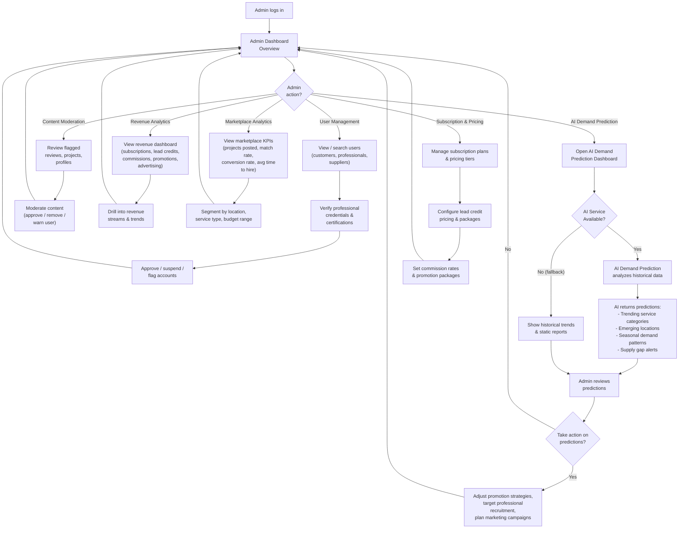
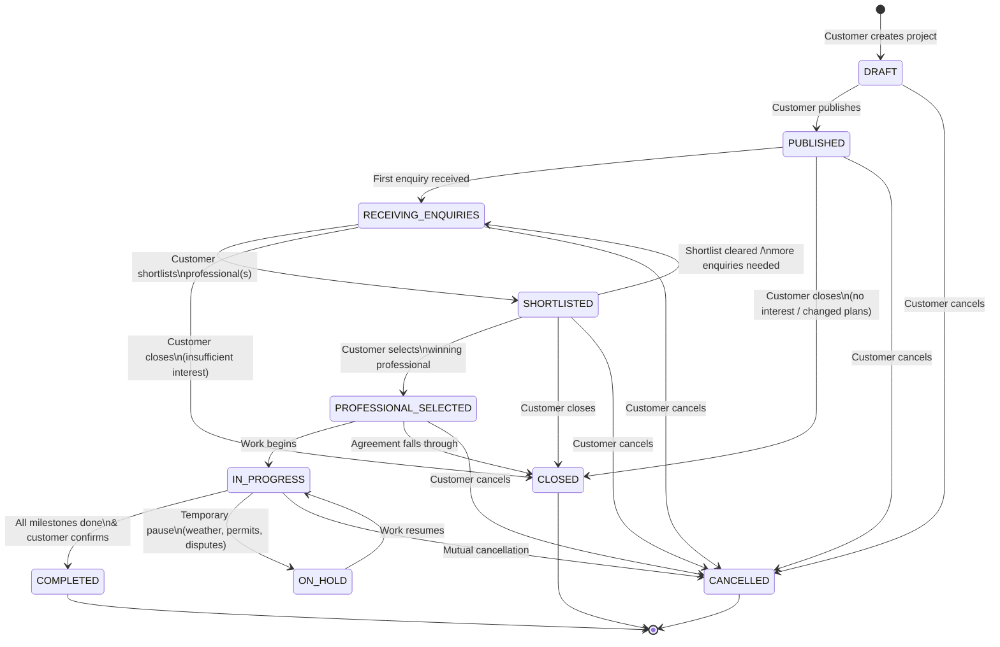

# Deliverable 2: User Journey Diagrams — BuildWise

> [!NOTE]
> This document maps **all 6 core workflows** of the BuildWise AI-powered construction marketplace, plus the complete **project lifecycle state machine**. Each workflow is rendered as a Mermaid flowchart showing decision points, AI service interactions, and fallback paths.

---

## Table of Contents

1. [Workflow A — Customer Creates a Construction Project](#workflow-a--customer-creates-a-construction-project)
2. [Workflow B — Professional Discovers a Project](#workflow-b--professional-discovers-a-project)
3. [Workflow C — Quotation Submission & Comparison](#workflow-c--quotation-submission--comparison)
4. [Workflow D — Material Supplier Discovery](#workflow-d--material-supplier-discovery)
5. [Workflow E — Project Progress Management](#workflow-e--project-progress-management)
6. [Workflow F — Admin Marketplace Intelligence](#workflow-f--admin-marketplace-intelligence)
7. [Project Lifecycle State Machine](#project-lifecycle-state-machine)

---

## Workflow A — Customer Creates a Construction Project

This journey covers the end-to-end flow from a customer's initial idea through AI-assisted requirement analysis, cost estimation, and budget optimization to a published project listing.

```mermaid
flowchart TD
    A1["Customer logs in"] --> A2["Navigate to 'Create Project'"]
    A2 --> A3["Enter project basics\n(title, type, location, description)"]
    A3 --> A4["Upload reference documents\n(floor plans, sketches, PDFs)"]
    A4 --> A5{"Trigger AI\nRequirement Analyzer?"}

    A5 -- "Yes" --> A6["AI Requirement Analyzer\nparses documents & description"]
    A5 -- "No / Skip" --> A7["Manually define\nrequirements & scope"]

    A6 --> A6a{"AI Service\nAvailable?"}
    A6a -- "Yes" --> A8["AI returns structured\nrequirements list"]
    A6a -- "No (fallback)" --> A7

    A8 --> A9["Customer reviews &\nedits requirements"]
    A7 --> A9

    A9 --> A10["Save requirements\nto project"]
    A10 --> A11{"Request AI\nCost Estimation?"}

    A11 -- "Yes" --> A12["AI Cost Estimator\nanalyzes scope & location"]
    A11 -- "No / Skip" --> A13["Customer sets\nmanual budget range"]

    A12 --> A12a{"AI Service\nAvailable?"}
    A12a -- "Yes" --> A14["AI returns estimated\ncost breakdown"]
    A12a -- "No (fallback)" --> A13

    A14 --> A15["Customer reviews\ncost estimates"]
    A13 --> A15

    A15 --> A16{"Request AI\nBudget Optimization?"}
    A16 -- "Yes" --> A17["AI Budget Optimizer\nsuggests alternatives"]
    A16 -- "No / Skip" --> A19["Finalize budget"]

    A17 --> A17a{"AI Service\nAvailable?"}
    A17a -- "Yes" --> A18["AI returns optimization\nrecommendations\n(material swaps, phasing)"]
    A17a -- "No (fallback)" --> A19

    A18 --> A19
    A19 --> A20["Set project timeline\n& required services"]
    A20 --> A21["Review full\nproject summary"]
    A21 --> A22{"Publish or\nSave as Draft?"}
    A22 -- "Save Draft" --> A23["Project saved\nas DRAFT"]
    A22 -- "Publish" --> A24["Project status → PUBLISHED"]
    A24 --> A25["Notifications sent to\nmatching professionals"]
    A25 --> A26["Project visible in\nmarketplace search"]
```

---

## Workflow B — Professional Discovers a Project

This journey shows how a professional finds relevant projects, expresses interest, and becomes shortlisted.

---

## Workflow C — Quotation Submission & Comparison

This journey covers how shortlisted professionals submit quotations and how the customer compares them — including AI-powered document analysis and intelligent comparison.

---

## Workflow D — Material Supplier Discovery

This journey shows how customers and professionals find and engage with material suppliers through the BuildWise supplier marketplace.

---

## Workflow E — Project Progress Management

This journey covers how customers and professionals collaborate to track milestones, updates, expenses, and documents throughout a project's lifecycle.

---

## Workflow F — Admin Marketplace Intelligence

This journey shows how platform administrators use analytics dashboards and AI-powered demand prediction to manage and grow the BuildWise marketplace.

---

## Project Lifecycle State Machine

This state diagram shows every valid state transition for a BuildWise project, including the happy path and cancel/close states.

### State Descriptions

| State | Description | Allowed Actions |
|---|---|---|
| **DRAFT** | Project created but not visible to professionals | Edit, upload, AI analysis, publish, cancel |
| **PUBLISHED** | Live in marketplace, visible to professionals | Receive enquiries, close, cancel |
| **RECEIVING_ENQUIRIES** | At least one professional has expressed interest | Review enquiries, shortlist, close, cancel |
| **SHORTLISTED** | Customer has shortlisted one or more professionals | Invite quotations, select professional, close, cancel |
| **PROFESSIONAL_SELECTED** | Winning professional chosen, pre-start phase | Finalize terms, begin work, close, cancel |
| **IN_PROGRESS** | Active construction / service delivery underway | Track progress, milestones, expenses, messages, hold, complete, cancel |
| **ON_HOLD** | Temporarily paused (awaiting permits, weather, etc.) | Resume, cancel |
| **COMPLETED** | All work finished and confirmed by customer | Leave reviews, archive |
| **CANCELLED** | Project cancelled at any stage | Archive, no further actions |
| **CLOSED** | Project closed without completion (lack of interest, changed plans) | Archive, no further actions |
