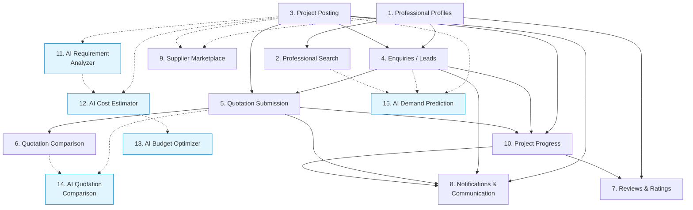

# Deliverable 3: Feature Interaction Matrix — BuildWise

> [!NOTE]
> This matrix maps **all 15 features** of the BuildWise platform, showing their user roles, inter-feature dependencies, database tables, AI services used, and fallback strategies. Use this as a reference for understanding how features interconnect and how the system degrades gracefully when dependencies fail.

---

## Feature Interaction Matrix

| # | Feature Name | User Roles | Depends On (Features) | Database Tables Used | AI Service Used | Fallback When Dependency Fails |
|---|---|---|---|---|---|---|
| 1 | **Professional Profiles** | Professional, Admin | — (foundational) | `users`, `profiles`, `professional_profiles`, `professional_services`, `professional_portfolios`, `professional_certifications` | None | N/A — core feature with no dependencies |
| 2 | **Professional Search** | Customer, Admin | 1 (Professional Profiles) | `professional_profiles`, `professional_services`, `users`, `reviews` | None | If F1 has no data, search returns empty results with prompt to "check back later". Basic search still functions without ratings data. |
| 3 | **Project Posting** | Customer | 11 (AI Requirement Analyzer — optional), 12 (AI Cost Estimator — optional), 13 (AI Budget Optimizer — optional) | `projects`, `project_requirements`, `project_attachments`, `project_services` | AI Requirement Analyzer, AI Cost Estimator, AI Budget Optimizer (all optional) | All AI services are optional enhancements. If any AI service is unavailable, customer enters requirements / budget manually. Project posting always works without AI. |
| 4 | **Enquiries / Leads** | Professional, Customer | 1 (Professional Profiles), 3 (Project Posting) | `project_enquiries`, `shortlisted_professionals`, `lead_credits`, `lead_credit_transactions`, `qualified_leads` | None | If lead credit service fails, enquiry is queued and processed when service recovers. Customer can still view project without enquiries. |
| 5 | **Quotation Submission** | Professional | 4 (Enquiries / Leads), 3 (Project Posting) | `quotations`, `quotation_items`, `quotation_versions`, `quotation_attachments` | None | If project data (F3) is temporarily unavailable, cached project summary is shown. Quotation can be saved as draft and submitted when dependency recovers. |
| 6 | **Quotation Comparison** | Customer | 5 (Quotation Submission), 14 (AI Quotation Comparison — optional) | `quotations`, `quotation_items`, `quotation_versions`, `quotation_analysis_jobs` | AI Quotation Comparison (optional) | If AI comparison is unavailable, system shows a basic side-by-side manual comparison table (price, timeline, items). If no quotations exist, prompt "awaiting quotations". |
| 7 | **Reviews & Ratings** | Customer, Professional | 1 (Professional Profiles), 10 (Project Progress) | `reviews`, `users`, `professional_profiles`, `projects` | None | Reviews can only be left after project completion (F10). If profile service (F1) is down, review is queued. Ratings aggregation runs asynchronously. |
| 8 | **Notifications & Communication** | Customer, Professional, Supplier, Admin | 3 (Project Posting), 4 (Enquiries), 5 (Quotations), 10 (Project Progress) | `notifications`, `messages`, `conversations` | None | Notification delivery uses retry queue with exponential backoff. If real-time delivery fails, notifications are stored and shown on next login (pull-based fallback). Messages stored regardless of delivery status. |
| 9 | **Supplier Marketplace** | Supplier, Customer, Professional | 1 (Professional Profiles — optional for linking), 3 (Project Posting — optional for linking) | `supplier_profiles`, `supplier_products`, `users`, `profiles` | None | Operates independently from core marketplace. If project linking (F3) is unavailable, supplier marketplace functions as standalone product catalog. |
| 10 | **Project Progress** | Customer, Professional | 3 (Project Posting), 4 (Enquiries), 5 (Quotation Submission) | `project_milestones`, `project_updates`, `project_expenses`, `project_documents`, `projects` | None | If expense tracking fails, milestone tracking and updates continue independently. Budget alerts deferred until expense service recovers. Document upload falls back to basic file storage. |
| 11 | **AI Requirement Analyzer** | Customer (via F3) | 3 (Project Posting — for input data) | `projects`, `project_requirements`, `project_attachments`, `ai_job_status` | **AI Requirement Analyzer** (independent service) | **Graceful degradation**: Customer manually enters requirements via form. UI hides AI button or shows "AI temporarily unavailable". Circuit breaker prevents cascading failures. Previously analyzed results remain cached. |
| 12 | **AI Cost Estimator** | Customer (via F3) | 3 (Project Posting), 11 (AI Requirement Analyzer — for structured requirements) | `projects`, `project_requirements`, `cost_estimation_records`, `ai_job_status` | **AI Cost Estimator** (independent service) | **Graceful degradation**: Customer enters manual budget range. System can show historical averages for similar project types if available. Circuit breaker isolates failure. No impact on project posting flow. |
| 13 | **AI Budget Optimizer** | Customer (via F3) | 12 (AI Cost Estimator — for cost baseline), 3 (Project Posting) | `projects`, `cost_estimation_records`, `budget_optimization_records`, `ai_job_status` | **AI Budget Optimizer** (independent service) | **Graceful degradation**: Customer proceeds with original cost estimate (F12) or manual budget. Optimization suggestions skipped. No impact on project creation or publishing. Previously generated optimizations remain viewable. |
| 14 | **AI Quotation Comparison** | Customer (via F6) | 5 (Quotation Submission), 6 (Quotation Comparison) | `quotations`, `quotation_items`, `quotation_attachments`, `quotation_analysis_jobs`, `ai_job_status` | **AI Quotation Comparison** (independent service) | **Graceful degradation**: System falls back to basic tabular comparison (price, timeline, line items). Document analysis skipped — attachments shown as downloadable files. Risk flags and value scoring unavailable. Manual comparison fully functional. |
| 15 | **AI Demand Prediction** | Admin (via F-admin) | 3 (Project Posting — historical data), 4 (Enquiries — historical data), 2 (Professional Search — supply data) | `projects`, `project_enquiries`, `professional_profiles`, `ai_prediction_records`, `ai_job_status`, `ai_model_registry` | **AI Demand Prediction** (independent service) | **Graceful degradation**: Admin dashboard shows historical trend charts and static reports instead of predictive analytics. Existing prediction results remain viewable. No impact on operational marketplace features. |

---

## Dependency Graph

The following diagram visualizes how the 15 features depend on one another. Solid arrows indicate hard dependencies; dashed arrows indicate optional / AI-enhanced dependencies.

> [!TIP]
> **Blue-shaded nodes** are AI services. All AI features are designed as **independent, optional services** with circuit breakers. The core marketplace (features 1–10) operates fully without any AI service running. This ensures the platform degrades gracefully rather than failing catastrophically.

---

## AI Service Isolation Summary

| AI Service | Operates Independently? | Circuit Breaker? | Cached Results? | Core Feature Impact on Failure |
|---|---|---|---|---|
| AI Requirement Analyzer | ✅ Yes | ✅ Yes | ✅ Yes | None — manual entry fallback |
| AI Cost Estimator | ✅ Yes | ✅ Yes | ✅ Yes | None — manual budget entry |
| AI Budget Optimizer | ✅ Yes | ✅ Yes | ✅ Yes | None — original estimate used |
| AI Quotation Comparison | ✅ Yes | ✅ Yes | ✅ Yes | None — tabular comparison fallback |
| AI Demand Prediction | ✅ Yes | ✅ Yes | ✅ Yes | None — historical charts shown |

---

## Cross-Role Feature Access Summary

| Feature | Customer | Professional | Supplier | Admin |
|---|---|---|---|---|
| 1. Professional Profiles | View | Create / Edit / View | — | Verify / Moderate |
| 2. Professional Search | Search / Filter | View own ranking | — | Analytics |
| 3. Project Posting | Create / Edit / Publish | View / Search | — | Moderate |
| 4. Enquiries / Leads | Receive / Review / Shortlist | Submit / Track | — | Monitor |
| 5. Quotation Submission | Receive / Review | Create / Submit / Revise | — | Monitor |
| 6. Quotation Comparison | Compare / Select | View outcome | — | Analytics |
| 7. Reviews & Ratings | Write / View | Write / View | — | Moderate |
| 8. Notifications & Communication | Receive / Send | Receive / Send | Receive / Send | Broadcast / Configure |
| 9. Supplier Marketplace | Browse / Enquire | Browse / Enquire | Manage products / Respond | Moderate |
| 10. Project Progress | View / Confirm | Manage / Update | — | Monitor |
| 11. AI Requirement Analyzer | Use (via project creation) | — | — | Monitor health |
| 12. AI Cost Estimator | Use (via project creation) | — | — | Monitor health |
| 13. AI Budget Optimizer | Use (via project creation) | — | — | Monitor health |
| 14. AI Quotation Comparison | Use (via quotation review) | — | — | Monitor health |
| 15. AI Demand Prediction | — | — | — | Use / Configure |
