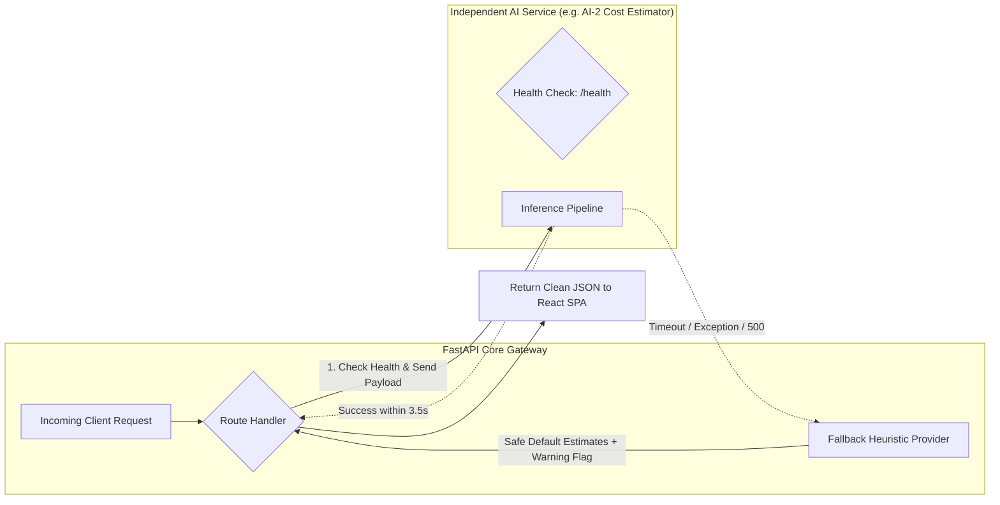

# Deliverable 4: System Architecture Diagram — BuildWise

> [!NOTE]
> This document details the technical infrastructure, communication topology, fault-isolation barriers, and circuit-breaker patterns powering BuildWise. Every component is architected for loose coupling and high resilience.

---

## 1. High-Level System Architecture Diagram

```mermaid
graph TB
    subgraph ClientLayer ["Client Presentation Layer (SPA)"]
        SPA["React 18 + Vite + Tailwind CSS SPA\n(React Router v6 + React Query + Zustand)"]
    end

    subgraph GatewayLayer ["Application Gateway & API Layer"]
        FastAPI["FastAPI Modular Backend (Python 3.11+)\n• Uvicorn ASGI Server\n• JWT Auth & RBAC Middleware\n• Rate Limiter & Audit Logger\n• Pydantic v2 Schema Validator"]
    end

    subgraph CoreServices ["Core Business Services (Internal Modular Routers)"]
        AuthSvc["Auth & Users Router"]
        ProfSvc["Professionals Router"]
        ProjSvc["Projects & Leads Router"]
        QuoteSvc["Quotations & Comparison Router"]
        ProgSvc["Project Progress Router"]
        SuppSvc["Supplier Marketplace Router"]
        BizSvc["Monetization & Billing Router"]
    end

    subgraph DataLayer ["Data & Storage Layer (Supabase)"]
        PG[("PostgreSQL 15 (Supabase)\n• Relational Tables\n• Row Level Security (RLS)\n• ACID Transactions & Triggers")]
        Storage["Supabase Object Storage\n• Blueprints Bucket\n• Portfolio Bucket\n• Quotation Documents Bucket\n• Site Photos Bucket"]
    end

    subgraph CircuitBreakerLayer ["Circuit Breaker & Fallback Manager"]
        CB["FastAPI Resilient AI Adapter\n• Concurrency Gatekeeper\n• 3.5s Timeout Watchdog\n• Fallback Engine (Static Heuristics)"]
    end

    subgraph AIServicesLayer ["Independent AI Services Tier (Isolated Microservices / Workers)"]
        AI1["AI Service 1: Requirement Analyzer\n• LLM Prompt Orchestrator\n• Schema Extraction & JSON Guard"]
        AI2["AI Service 2: Cost Estimator\n• Scikit-Learn / XGBoost Regressor\n• Pretrained Goa/India Construction Data"]
        AI3["AI Service 3: Budget Optimizer\n• Linear Optimization / Heuristics\n• Material Alternative Recommendation"]
        AI4["AI Service 4: Quotation Intelligence\n• OCR Pipeline (Tesseract / PDFPlumber)\n• Vision / LLM Table Extraction\n• Async Background Worker (Celery/AsyncIO)"]
        AI5["AI Service 5: Demand Prediction\n• Prophet / SARIMAX Time-Series\n• Regional Construction Activity Forecaster"]
    end

    SPA -->|HTTPS / REST API (JSON)| FastAPI
    FastAPI --> AuthSvc
    FastAPI --> ProfSvc
    FastAPI --> ProjSvc
    FastAPI --> QuoteSvc
    FastAPI --> ProgSvc
    FastAPI --> SuppSvc
    FastAPI --> BizSvc

    CoreServices -->|Supabase Client / PostgREST / Asyncpg| PG
    CoreServices -->|Signed S3-Compatible Uploads/Downloads| Storage

    ProjSvc --> CB
    QuoteSvc --> CB
    BizSvc --> CB

    CB -->|HTTP / Async Post (Timeout 4s)| AI1
    CB -->|Local Inference / HTTP API| AI2
    CB -->|HTTP API| AI3
    CB -->|Async Job Queue & Polling| AI4
    CB -->|HTTP API (Admin Only)| AI5
```

---

## 2. Service Boundaries & Fault-Isolation Topology

A critical constraint of BuildWise is **fault isolation**. Under no circumstance should a failure, timeout, or invalid output in any AI service impact core transactional marketplace actions.



### Circuit Breaker States & Fallback Strategy

| AI Service | Normal Operation | Failure / Timeout Trigger | Fallback Behavior |
| :--- | :--- | :--- | :--- |
| **AI-1: Requirement Analyzer** | Extracts structured fields from freeform text. | Response exceeds 4.5s or model output is unparseable. | System prompts customer with structured step-by-step form (Location, Area, Bedrooms, Budget). |
| **AI-2: Cost Estimator** | Returns predicted ₹ cost breakdown by sq. ft. and category. | Model artifact loading error or runtime exception. | Returns historical Goa rule-of-thumb ranges (₹1,800–₹2,400/sq.ft for Standard) and flags `"source": "benchmark_fallback"`. |
| **AI-3: Budget Optimizer** | Calculates material swaps and phased cost cuts. | Optimization solver exceeds compute window. | Returns standard industry cost-saving suggestions (e.g., standard vs. Italian marble, phased landscape work). |
| **AI-4: Quotation Intelligence** | Asynchronously parses uploaded contractor PDF/Excel. | OCR unreadable, scan quality too low, or parser failure. | Job marked `FAILED_MANUAL_REVIEW_REQUIRED`; user invited to enter line items manually into structured comparison grid. |
| **AI-5: Demand Prediction** | Forecasts category and regional trade demand. | Insufficient sample size (<10 projects per zip). | Admin dashboard renders actual historical histograms with notice: *"Predictive forecasting requires minimum 30 historical records"*. |

---

## 3. Communication Protocols & Security Layers

1. **Client-to-Backend:**
   - HTTPS with TLS 1.3.
   - Bearer Authentication via Supabase JWT with auto-refresh token handling.
   - CORS restricted to registered SPA domain/localhost ports.
2. **Backend-to-Database:**
   - Direct connection pooling with SSL mode enforced.
   - RLS policies enforced based on `auth.uid()` claims.
3. **Backend-to-AI Microservices:**
   - Internal secure network loopback or microservice endpoint.
   - Strict request and response serialization with Pydantic v2 validation contracts.
4. **Storage Protocol:**
   - Direct browser-to-bucket upload via short-lived pre-signed URLs to protect backend bandwidth.
