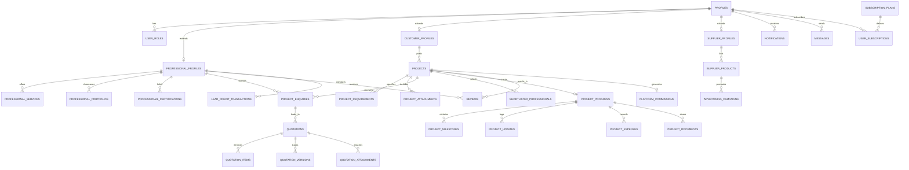

# Deliverable 5: Database ER Diagram & Schema Specification — BuildWise

> [!NOTE]
> BuildWise uses a normalized **PostgreSQL 15** database managed via **Supabase**. The schema guarantees relational integrity, strict foreign key constraints, comprehensive indexing for geolocation and search, and Row Level Security (RLS) policies safeguarding user privacy and commercial transactions.

---

## 1. High-Level Entity Relationship Diagram (ERD)

---

## 2. Relational Table Specifications

### A. Core Authentication & Personas

#### `profiles` (extends `auth.users`)
- `id`: UUID (PK, FK → `auth.users.id`, ON DELETE CASCADE)
- `email`: VARCHAR(255) NOT NULL UNIQUE
- `full_name`: VARCHAR(255) NOT NULL
- `phone`: VARCHAR(20)
- `avatar_url`: TEXT
- `role`: VARCHAR(30) NOT NULL CHECK (role IN ('customer', 'professional', 'supplier', 'admin'))
- `is_verified`: BOOLEAN DEFAULT FALSE
- `created_at`: TIMESTAMPTZ DEFAULT NOW()
- `updated_at`: TIMESTAMPTZ DEFAULT NOW()

#### `professional_profiles`
- `id`: UUID (PK, FK → `profiles.id`, ON DELETE CASCADE)
- `company_name`: VARCHAR(255)
- `category`: VARCHAR(50) NOT NULL CHECK (category IN ('contractor', 'architect', 'civil_engineer', 'interior_designer', 'structural_consultant'))
- `experience_years`: INT NOT NULL CHECK (experience_years >= 0)
- `license_number`: VARCHAR(100)
- `gstin`: VARCHAR(20)
- `location_district`: VARCHAR(100) NOT NULL DEFAULT 'North Goa'
- `service_regions`: TEXT[] DEFAULT ARRAY['North Goa', 'South Goa']
- `budget_tier`: VARCHAR(30) DEFAULT 'mid-range' CHECK (budget_tier IN ('economy', 'mid-range', 'premium', 'luxury'))
- `bio`: TEXT
- `website`: TEXT
- `average_rating`: NUMERIC(3,2) DEFAULT 0.00
- `review_count`: INT DEFAULT 0
- `lead_credits_balance`: INT DEFAULT 50 -- Starting bonus credits
- `is_available`: BOOLEAN DEFAULT TRUE
- `subscription_tier`: VARCHAR(30) DEFAULT 'free' CHECK (subscription_tier IN ('free', 'basic', 'premium'))

#### `customer_profiles`
- `id`: UUID (PK, FK → `profiles.id`, ON DELETE CASCADE)
- `default_location`: VARCHAR(100) DEFAULT 'Goa'
- `preferred_contact`: VARCHAR(20) DEFAULT 'phone'
- `projects_count`: INT DEFAULT 0

#### `supplier_profiles`
- `id`: UUID (PK, FK → `profiles.id`, ON DELETE CASCADE)
- `business_name`: VARCHAR(255) NOT NULL
- `gstin`: VARCHAR(20) NOT NULL
- `warehouse_location`: VARCHAR(255) NOT NULL
- `delivery_districts`: TEXT[] DEFAULT ARRAY['North Goa', 'South Goa']
- `minimum_order_value`: NUMERIC(12,2) DEFAULT 0.00
- `rating`: NUMERIC(3,2) DEFAULT 0.00

---

### B. Marketplace Projects & Matching

#### `projects`
- `id`: UUID (PK, DEFAULT gen_random_uuid())
- `customer_id`: UUID NOT NULL (FK → `profiles.id`, ON DELETE CASCADE)
- `title`: VARCHAR(255) NOT NULL
- `description`: TEXT NOT NULL
- `category`: VARCHAR(50) NOT NULL CHECK (category IN ('new_residential', 'renovation', 'commercial', 'interior_design', 'structural_work'))
- `location_address`: TEXT NOT NULL
- `district`: VARCHAR(100) NOT NULL CHECK (district IN ('North Goa', 'South Goa', 'Other'))
- `built_up_area_sqft`: NUMERIC(10,2) NOT NULL
- `floors_count`: INT DEFAULT 1
- `estimated_budget`: NUMERIC(14,2) NOT NULL
- `required_services`: TEXT[] NOT NULL -- e.g., ['architecture', 'civil_construction', 'plumbing']
- `preferred_timeline_months`: INT DEFAULT 6
- `status`: VARCHAR(40) NOT NULL DEFAULT 'draft' CHECK (status IN ('draft', 'published', 'receiving_enquiries', 'shortlisted', 'professional_selected', 'in_progress', 'completed', 'cancelled'))
- `selected_professional_id`: UUID (FK → `professional_profiles.id`, NULLABLE)
- `agreed_project_value`: NUMERIC(14,2)
- `created_at`: TIMESTAMPTZ DEFAULT NOW()
- `updated_at`: TIMESTAMPTZ DEFAULT NOW()

#### `project_enquiries` (Leads)
- `id`: UUID (PK, DEFAULT gen_random_uuid())
- `project_id`: UUID NOT NULL (FK → `projects.id`, ON DELETE CASCADE)
- `professional_id`: UUID NOT NULL (FK → `professional_profiles.id`, ON DELETE CASCADE)
- `pitch_message`: TEXT
- `credits_deducted`: INT NOT NULL DEFAULT 10
- `status`: VARCHAR(30) DEFAULT 'submitted' CHECK (status IN ('submitted', 'shortlisted', 'declined', 'quotation_requested', 'awarded'))
- `created_at`: TIMESTAMPTZ DEFAULT NOW()
- CONSTRAINT `unique_project_pro_enquiry` UNIQUE (project_id, professional_id)

---

### C. Quotations & Audit Engine

#### `quotations`
- `id`: UUID (PK, DEFAULT gen_random_uuid())
- `project_id`: UUID NOT NULL (FK → `projects.id`, ON DELETE CASCADE)
- `professional_id`: UUID NOT NULL (FK → `professional_profiles.id`, ON DELETE CASCADE)
- `version`: INT DEFAULT 1
- `total_estimated_price`: NUMERIC(14,2) NOT NULL
- `material_cost`: NUMERIC(14,2) NOT NULL
- `labour_cost`: NUMERIC(14,2) NOT NULL
- `transport_charges`: NUMERIC(10,2) DEFAULT 0.00
- `service_fee`: NUMERIC(10,2) DEFAULT 0.00
- `completion_timeline_days`: INT NOT NULL
- `validity_date`: DATE NOT NULL
- `terms_and_conditions`: TEXT
- `included_services`: TEXT[]
- `excluded_services`: TEXT[]
- `status`: VARCHAR(30) DEFAULT 'submitted' CHECK (status IN ('draft', 'submitted', 'under_review', 'accepted', 'rejected', 'superseded'))
- `created_at`: TIMESTAMPTZ DEFAULT NOW()

#### `quotation_items`
- `id`: UUID (PK, DEFAULT gen_random_uuid())
- `quotation_id`: UUID NOT NULL (FK → `quotations.id`, ON DELETE CASCADE)
- `item_category`: VARCHAR(50) NOT NULL CHECK (item_category IN ('civil_structure', 'masonry', 'flooring', 'electrical', 'plumbing', 'painting', 'finishing', 'misc'))
- `item_name`: VARCHAR(255) NOT NULL
- `unit`: VARCHAR(50) NOT NULL -- e.g., 'sq.ft', 'bags', 'metric tons', 'running ft'
- `quantity`: NUMERIC(10,2) NOT NULL
- `unit_rate`: NUMERIC(12,2) NOT NULL
- `total_price`: NUMERIC(14,2) NOT NULL

#### `quotation_analysis_jobs` (For AI Document Audits)
- `id`: UUID (PK, DEFAULT gen_random_uuid())
- `project_id`: UUID NOT NULL (FK → `projects.id`, ON DELETE CASCADE)
- `uploaded_by`: UUID NOT NULL (FK → `profiles.id`)
- `document_url`: TEXT NOT NULL
- `file_type`: VARCHAR(20) NOT NULL CHECK (file_type IN ('pdf', 'xlsx', 'docx', 'image'))
- `status`: VARCHAR(30) DEFAULT 'pending' CHECK (status IN ('pending', 'processing', 'completed', 'failed'))
- `extracted_data`: JSONB
- `discrepancies_detected`: JSONB
- `error_message`: TEXT
- `created_at`: TIMESTAMPTZ DEFAULT NOW()

---

### D. Progress Tracking & Milestone Management

#### `project_milestones`
- `id`: UUID (PK, DEFAULT gen_random_uuid())
- `project_id`: UUID NOT NULL (FK → `projects.id`, ON DELETE CASCADE)
- `milestone_name`: VARCHAR(255) NOT NULL
- `sequence_order`: INT NOT NULL
- `planned_start_date`: DATE
- `planned_end_date`: DATE
- `actual_completion_date`: DATE
- `allocated_amount`: NUMERIC(14,2) NOT NULL
- `status`: VARCHAR(30) DEFAULT 'pending' CHECK (status IN ('pending', 'in_progress', 'completed', 'verified_by_customer'))

#### `project_updates` (Site Photo Logs)
- `id`: UUID (PK, DEFAULT gen_random_uuid())
- `project_id`: UUID NOT NULL (FK → `projects.id`, ON DELETE CASCADE)
- `posted_by`: UUID NOT NULL (FK → `profiles.id`)
- `title`: VARCHAR(255) NOT NULL
- `description`: TEXT
- `completion_percentage`: INT CHECK (completion_percentage BETWEEN 0 AND 100)
- `photo_urls`: TEXT[] DEFAULT ARRAY[]::TEXT[]
- `created_at`: TIMESTAMPTZ DEFAULT NOW()

---

### E. Commercial & Monetization Records

#### `lead_credit_transactions`
- `id`: UUID (PK, DEFAULT gen_random_uuid())
- `professional_id`: UUID NOT NULL (FK → `professional_profiles.id`, ON DELETE CASCADE)
- `amount`: INT NOT NULL -- Positive for purchase, negative for lead unlock
- `balance_after`: INT NOT NULL
- `transaction_type`: VARCHAR(50) NOT NULL CHECK (transaction_type IN ('signup_bonus', 'pack_purchase', 'lead_unlock', 'refund_admin'))
- `project_id`: UUID (FK → `projects.id`, NULLABLE)
- `created_at`: TIMESTAMPTZ DEFAULT NOW()

#### `platform_commissions`
- `id`: UUID (PK, DEFAULT gen_random_uuid())
- `project_id`: UUID NOT NULL UNIQUE (FK → `projects.id`)
- `agreed_project_value`: NUMERIC(14,2) NOT NULL
- `commission_percentage`: NUMERIC(4,2) DEFAULT 2.00
- `commission_amount`: NUMERIC(14,2) NOT NULL
- `status`: VARCHAR(30) DEFAULT 'accrued' CHECK (status IN ('accrued', 'invoiced', 'collected', 'waived'))
- `created_at`: TIMESTAMPTZ DEFAULT NOW()

---

## 3. Row-Level Security (RLS) Policy Specifications

1. **`profiles`:**
   - Public: Read basic profile (name, avatar, role, verification status).
   - Owner (`auth.uid() = id`): Read/Update full profile.
2. **`projects`:**
   - Public: Read published projects (`status != 'draft'`).
   - Customer (`auth.uid() = customer_id`): Full CRUD on owned projects.
   - Selected Contractor: Read-only access to awarded private notes.
3. **`quotations`:**
   - Contractor (`auth.uid() = professional_id`): Full CRUD on owned quotations.
   - Project Owner (`auth.uid() = (SELECT customer_id FROM projects WHERE id = project_id)`): Read submitted quotations for their project.
4. **`lead_credit_transactions` & `platform_commissions`:**
   - Strictly restricted to account owner and `role = 'admin'`.
