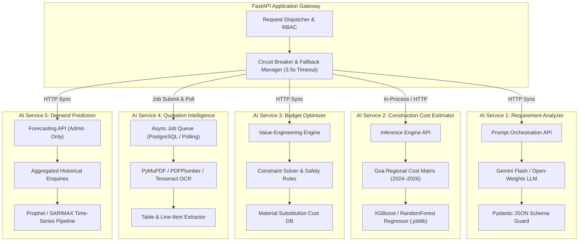
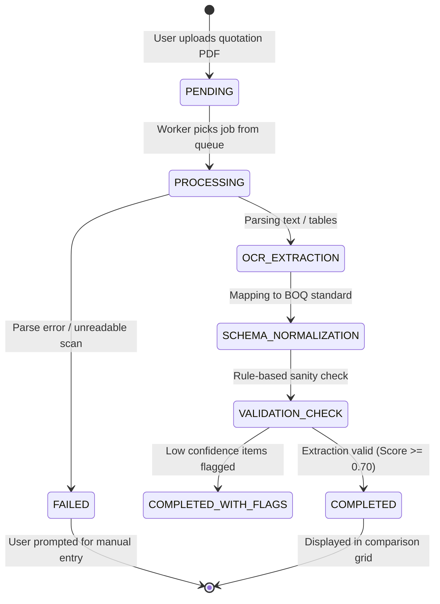

# Deliverable 7: AI Architecture — BuildWise

> [!IMPORTANT]
> **Strict Architectural Mandate: Independent Models & Fault Isolation.**
> BuildWise rejects the single-monolithic-model antipattern. Each AI capability operates as an autonomous service with its own inference runtime, distinct input/output contracts, independent failure domains, and automated fallback logic. Failure of one AI component never impacts other AI features or core marketplace operations.

---

## 1. Multi-Model Topology & Failure Isolation

---

## 2. Deep Dive: The 5 Independent AI Services

### AI Service 1: Construction Requirement Analyzer
- **Purpose:** Converts conversational, unstructured customer descriptions into standardized project specification objects and identifies missing engineering details.
- **Input:** Raw text, e.g., *"I want to build a two-storey house in Margao with 4 bedrooms, modular kitchen, and parking for 2 cars. My budget is around ₹45 lakh."*
- **Technology & Pipeline:**
  1. Few-shot prompt template grounded in Indian construction norms.
  2. Strict Pydantic output validation schema: `{"project_type": str, "location": str, "built_up_area_sqft": Optional[float], "floors": int, "budget": float, "bedrooms": int, "special_features": [str], "missing_critical_info": [str]}`.
  3. Automatic follow-up query generator for missing parameters (e.g., plot dimensions, soil conditions).
- **Fallback:** Renders a clean 4-step wizard form allowing the customer to enter basic dimensions directly.

---

### AI Service 2: Construction Cost Estimator
- **Purpose:** Produces deterministic, validated construction cost projections per square foot, total budget estimates, and high-level component distributions.
- **Input Features:**
  - `district` (Categorical: North Goa, South Goa)
  - `built_up_area_sqft` (Continuous: 500 – 15,000)
  - `floors_count` (Integer: 1 – 5)
  - `project_type` (Categorical: New Construction, Renovation, Villa, Apartment)
  - `material_finish_tier` (Categorical: Economy, Standard, Premium, Luxury)
- **Model & Training:**
  - **Algorithm:** Tuned Gradient Boosting Regressor (`scikit-learn` / `xgboost`).
  - **Training Data:** Curated regional dataset of 1,200+ Goa & Western Coastal construction projects adjusted for current material indexes (cement, TMT steel, local laterite stone vs. fly-ash bricks).
  - **Evaluation Metrics:** Mean Absolute Percentage Error (MAPE) target < 6.5%, $R^2 > 0.92$.
- **Output:**
  - `estimated_total`: e.g., ₹42,50,000
  - `confidence_interval`: [₹40,20,000, ₹44,80,000] (never pretends precision down to single rupees)
  - `cost_per_sqft`: e.g., ₹2,125/sq.ft
  - `component_breakdown`: Civil & Structure (48%), Material finishes (24%), Labour (15%), MEP Services (8%), Approvals & Misc (5%).
- **Fallback:** Regional statutory rate lookup table with fallback disclaimer tag.

---

### AI Service 3: Budget Optimizer
- **Purpose:** Rescues over-budget projects by providing actionable value-engineering trade-offs without compromising structural or seismic safety.
- **Engineering Guardrails:** Structural elements (foundation depth, RCC pillar grades M25, rebar diameter Fe550D) are flagged as **NON-NEGOTIABLE** invariants.
- **Optimization Strategy:**
  1. Evaluates discretionary finishes: Flooring (Italian Marble → Glazed Vitrified Tiles saves ~₹180/sq.ft).
  2. Evaluates fenestration: Premium Teak wood frames → UPVC double-glazed profiles (saves ~15%).
  3. Evaluates project phasing: Postponing exterior landscaping or terrace solar pergola to Phase 2 (saves immediate cash outlays by ₹4,00,000).
- **Output:** Ranked list of trade-offs, itemized potential savings, and net impact on the target budget.

---

### AI Service 4: Quotation Intelligence (Document Audit & OCR)
- **Purpose:** Ingests heterogeneous contractor quotations (scanned PDFs, Excel spreadsheets, smartphone camera photos) and standardizes them into a normalized comparison schema.
- **Asynchronous Architecture:**
  1. Customer uploads document → saved to Supabase Storage.
  2. Record created in `quotation_analysis_jobs` with status `PENDING`.
  3. Background worker extracts text via `pdfplumber` (native PDF) or `pytesseract` (scanned images).
  4. Structured LLM parser maps extracted lines to standard categories (`civil_structure`, `finishing`, `labour`, `taxes`).
  5. Validation rule flags anomalies (e.g., missing GST, omitted plumbing rough-ins, unusually low steel quotes indicative of substandard gauge).
  6. Job status updated to `COMPLETED` or `FAILED`.
- **Confidence Scoring:** Every extracted field carries a confidence percentage; any field under 70% confidence is highlighted with an "Inspect Source Document" badge.

---

### AI Service 5: Marketplace Demand Prediction
- **Purpose:** Provides macro-level market intelligence to platform administrators and registered professionals.
- **Methodology:** Time-series analysis over rolling 30/60/90-day intervals tracking:
  - Inquiries per trade category by taluka/district (e.g., North Goa vs. South Goa).
  - Supply density (number of active contractors vs. published leads).
- **Output:** Identifies underserved market niches (e.g., *"South Goa has experienced a 42% rise in renovation RFQs, but listed interior designers have only grown by 4%"*).
- **Fallback:** When historical project volume in a sector is `< 20`, predictive trendlines are suppressed, and raw counts are shown with an *"Emerging Region — Low Sample Size"* indicator.

---

## 3. Asynchronous Job State Machine (DocAI)

