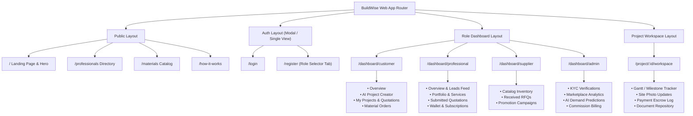

# Deliverable 8: UI/UX Blueprint & Design System — BuildWise

> [!NOTE]
> The BuildWise user experience is crafted to project enterprise credibility, industrial precision, and effortless accessibility. The application avoids unnecessary clutter, utilizing unified dashboard layouts with coherent sub-navigation to minimize page fragmentation.

---

## 1. Design System & Visual Identity

### Color System
- **Primary Brand (Deep Navy / Charcoal):** `#0F172A` (Slate 900) & `#1E293B` (Slate 800) — Represents engineering rigor, durability, and trust.
- **Secondary / Action Accent (Construction Amber / Electric Teal):** `#F59E0B` (Amber 500) & `#0EA5E9` (Sky 500) — Highlights key conversion actions, CTAs, and status milestones.
- **Background & Canvas:** `#F8FAFC` (Slate 50) and `#FFFFFF` (Pure White) with crisp `#E2E8F0` (Slate 200) container borders.
- **Semantic State Colors:**
  - Success: `#10B981` (Emerald 500) — Approved milestones, verified badges.
  - Warning: `#F59E0B` (Amber 500) — Expiring quotes, budget overruns.
  - Danger / Error: `#EF4444` (Red 500) — Declined proposals, circuit breaker alerts.
  - Neutral Subdued: `#64748B` (Slate 500) — Auxiliary metadata and captions.

### Typography & Spacing
- **Typography:** Inter or system sans-serif (`font-sans`), with tabular numbers (`tabular-nums`) for currency and cost estimates.
- **Elevation & Radius:** Clean `rounded-xl` cards, subtle `shadow-sm` borders (`ring-1 ring-slate-900/5`), avoiding heavy skeuomorphism or distracting animations.

---

## 2. Navigation Architecture & Role-Based Layouts

To maintain architectural cohesion without spawning dozens of detached pages, BuildWise organizes its views under **three top-level layouts**:
1. **Public Layout:** Minimalist header with navigation links (Discover Professionals, Materials, How It Works), Login/Register CTA, and informational footer.
2. **Unified Role Dashboard Layout:** Shared sidebar with role-aware navigational links, global header with notifications tray, lead credit counter (for contractors), and breadcrumb navigation.
3. **Project Progress Workspace:** Dedicated collaborative split-view workspace shared between customer and awarded contractor.

---

## 3. Key Screen Layout Blueprints

### A. Customer Project Studio (AI-Powered Creation Flow)
- **Top Bar:** Step tracker (1. Describe & Scope → 2. AI Estimate → 3. Value Engineering → 4. Review & Publish).
- **Left Panel (60%):** Rich text description input with instant AI keyword tagging (e.g., *Goa District: Margao*, *Type: 2-Storey Villa*, *Area: 2,400 sq.ft*).
- **Right Panel (40%):** Interactive AI Cost Calculator preview updating live as parameters change, showing estimated budget ranges with transparent breakdown bars (Civil, Finishes, Labour).

### B. Side-by-Side Quotation Comparison Grid
- **Sticky Column 1:** Parameter metrics (Total Price, Cost/sq.ft, Execution Timeline, Material Grade, Warranty, Payment Milestones).
- **Dynamic Columns 2–4:** Contractor cards with quotation summaries, line-item toggles, and discrepancy tags (e.g., `⚡ Missing waterproofing guarantee` or `✓ Premium Fe550D rebar specified`).
- **Upload Box:** Drag-and-drop zone for external PDF/Excel quotes with real-time AI parsing status spinner.

### C. Contractor Lead Discovery Board
- **Filter Rail:** Regional filter pills (North Goa, South Goa, Panaji, Margao, Mapusa), project budget brackets, and category tags.
- **Lead Cards:** Project title, location badge, estimated sq.ft, time posted, customer verified badge, and "Unlock Lead (10 Credits)" button displaying contractor's current credit balance.

### D. Progress Workspace & Photo Timeline
- **Milestone Progress Track:** Visual timeline showing status badges (`Completed`, `Under Review`, `Upcoming`).
- **Site Log Stream:** Chronological feed of on-site contractor uploads with high-resolution photo grids and timestamp watermarks.
- **Expense Log:** Running tally of approved milestones vs. remaining contract value.
